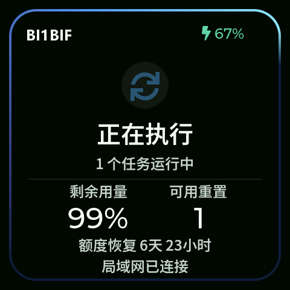
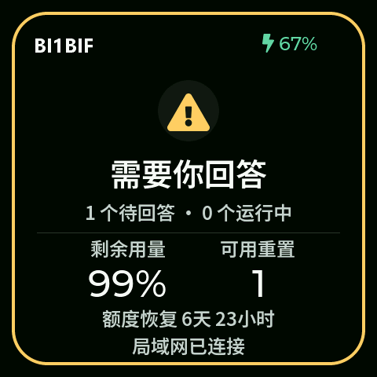
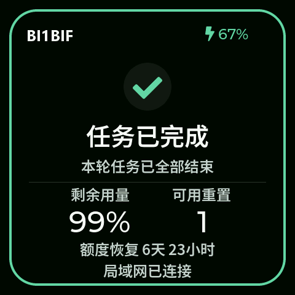
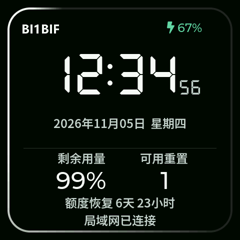

# Codex LAN Display

[简体中文](README.md) · English

A Wi-Fi desktop display for Codex usage and task activity. This edition targets Windows and the Waveshare ESP32-S3-Touch-AMOLED-2.16 board (480 × 480, 16 MB flash).

[Download Windows x64 EXE](https://github.com/BI1BIF/codex-lan-display/releases/latest/download/Codex-LAN-Display-Windows-x64.exe) · [Download ESP32-S3 firmware BIN](https://github.com/BI1BIF/codex-lan-display/releases/latest/download/Codex-LAN-Display-Waveshare-AMOLED-2.16.bin) · [Release notes and checksums](https://github.com/BI1BIF/codex-lan-display/releases/latest)

| Running | Waiting for input |
| :---: | :---: |
|  |  |

| Completed | Standby clock |
| :---: | :---: |
|  |  |

The display shows running, waiting for input, and completed states with distinct animated borders and optional sounds. After 15 seconds of inactivity it fades into a seven-segment clock. Usage remaining, available resets, recovery time, and battery status remain visible. Hold the touch screen to change brightness, volume, or Wi-Fi. The Windows tray companion starts at login and recovers from unexpected exits.

## Quick start

1. Sign in to the Codex desktop app and run the EXE. It runs in the Windows tray without a Python installation. To start it at sign-in, put a shortcut in `shell:startup`.
2. Verify the board is a **Waveshare ESP32-S3-Touch-AMOLED-2.16 (16 MB flash)**. Replace `COM7` with your device's serial port. **The merged image overwrites the old partition layout and device settings.** Use the source flash script below if you need to retain settings on the same partition layout.
3. Join the setup hotspot shown on the screen, open http://192.168.4.1/, and enter a reachable 2.4 GHz Wi-Fi network. Leave the PC address blank for mDNS, or enter its LAN IPv4 address.

```powershell
python -m pip install esptool==5.2.0
python -m esptool --chip esp32s3 --port COM7 --baud 460800 write-flash 0x0 Codex-LAN-Display-Waveshare-AMOLED-2.16.bin
```

## Build from source

1. Install Arduino CLI and Python 3.12. Install the pinned ESP32 core and Arduino libraries using the commands in [the build guide](README.md#1-编译和刷入). Run build.ps1 and then flash.ps1 with the correct serial port. The flash script uses the board-specific partition layout; verify your board and back up any firmware you want to keep. Charging settings are for the original battery.
2. In the Codex desktop app, sign in to your account. Create a Python environment at companion/.venv and install companion/requirements-lan.txt. Run install-tray.ps1. The companion launches the local Codex app-server. For non-Store installations, set CODEX_BIN to the installed codex.exe.
3. Join the setup hotspot shown on the screen, open http://192.168.4.1/, and enter a 2.4 GHz Wi-Fi network that can reach the PC. Leave the PC address blank for mDNS, or enter its LAN IPv4 address. If necessary, allow TCP 8738 on the Windows private network.

To rebuild the EXE, install `pyinstaller==6.19.0` in the companion virtual environment and run `package-windows.ps1`.

The settings page is http://127.0.0.1:8738/settings. The device receives status and usage summaries rather than prompt text or account credentials. LAN HTTP is unauthenticated and unencrypted, so use a trusted LAN and do not expose the port to the Internet.

See [LICENSE](LICENSE) and [third-party notices](THIRD_PARTY_NOTICES.md). This edition is based on Jay Yao's Codex Usage Display.
