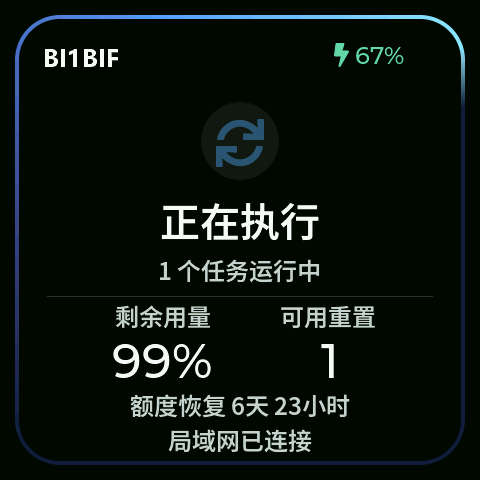
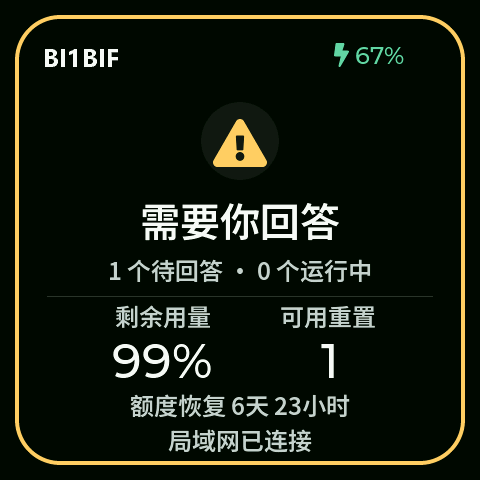
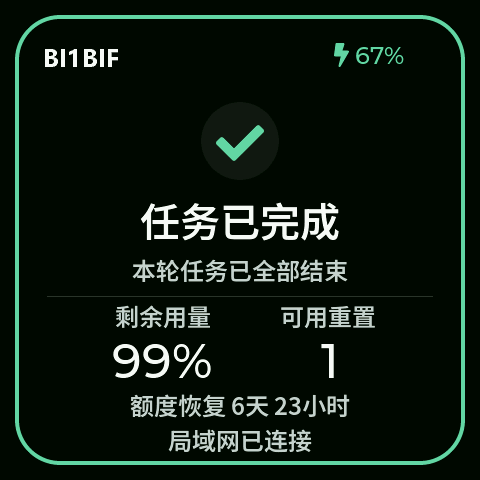
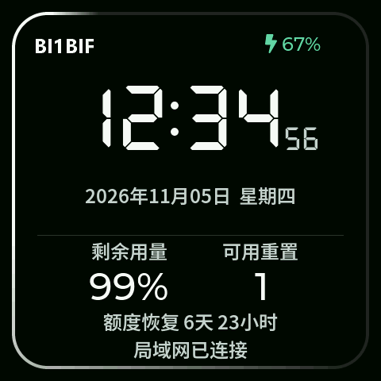

# Codex LAN Display

简体中文 · [English](README.en.md)

把 Codex 的任务状态和用量放到桌面小屏上。支持 **Windows + Waveshare ESP32-S3-Touch-AMOLED-2.16（480 × 480，16 MB Flash）**。小屏通过 Wi-Fi 从电脑读取数据，无需蓝牙或 API Key。

[下载 Windows x64 桌面端](https://github.com/BI1BIF/codex-lan-display/releases/latest/download/Codex-LAN-Display-Windows-x64.exe) · [下载小屏固件 BIN](https://github.com/BI1BIF/codex-lan-display/releases/latest/download/Codex-LAN-Display-Waveshare-AMOLED-2.16.bin) · [查看版本与 SHA-256](https://github.com/BI1BIF/codex-lan-display/releases/latest)

| 运行中 | 等待回答 |
| :---: | :---: |
|  |  |

| 任务完成 | 待机时钟 |
| :---: | :---: |
|  |  |

- 运行时蓝色渐变光环，等待回答时黄色呼吸，完成后绿色提示。
- 完成或空闲 15 秒后进入七段数码时钟，白色光环每分钟一圈。
- 显示周额度、可用重置次数和恢复倒计时。账号有 5 小时额度时，额外显示剩余百分比和按小时、分钟计的重置倒计时。支持自定义左上角文字。
- 支持四方向自动旋转、电池电量与充电提示。长按屏幕调节亮度与提示音音量。
- Windows 托盘在登录后启动，异常退出后由计划任务拉起。

## 快速安装

1. 在 Codex 桌面应用登录，双击 EXE。程序会出现在 Windows 托盘里，无需安装 Python。需要登录时启动，可把 EXE 的快捷方式放到 `shell:startup`。
2. 确认板型是 **Waveshare ESP32-S3-Touch-AMOLED-2.16（16 MB Flash）**，查出串口后刷入合并镜像。下面用 `COM7` 举例。**合并镜像会覆盖原分区和设备设置，刷入后需要重新配网。** 要保留同版分区布局中的设置，请使用下方的分段刷写方法。
3. 按[连接小屏](#3-连接小屏)完成配网。电脑和小屏需在可互通的局域网内。

```powershell
python -m pip install esptool==5.2.0
python -m esptool --chip esp32s3 --port COM7 --baud 460800 write-flash 0x0 Codex-LAN-Display-Waveshare-AMOLED-2.16.bin
```

## 从源码安装

## 1. 编译和刷入

在 PowerShell 中运行。先安装 Arduino CLI 和 Python 3.12，关闭占用串口的串口监视器。

    arduino-cli core update-index --additional-urls https://espressif.github.io/arduino-esp32/package_esp32_index.json
    arduino-cli core install esp32:esp32@3.3.8 --additional-urls https://espressif.github.io/arduino-esp32/package_esp32_index.json
    arduino-cli lib install 'ArduinoJson@7.4.2' 'GFX Library for Arduino@1.6.6' 'SensorLib@0.3.3' 'XPowersLib@0.2.6' 'lvgl@8.4.0'
    .\build.ps1

用设备管理器或 arduino-cli board list 确认串口。以下 COM7 只是示例；烧录前请确认板型，必要时备份原固件。此固件对原配电池使用微雪示例的 4.2 V / 400 mA 充电配置；更换电池前请核对规格。

    python -m pip install esptool==5.2.0
    .\flash.ps1 -Port COM7

脚本按本项目分区表写入 OTA 数据。不要使用其他项目的合并镜像或默认 OTA 地址。编译输出默认在 Windows 公共目录的 CodexDisplayBuild/output；可通过 -BuildRoot 自定义纯 ASCII 路径。Arduino CLI 不在 PATH 时向 build.ps1 传入 -ArduinoCli 的完整路径。

## 2. 启动电脑后台

在 Codex 桌面应用登录后，在项目目录运行：

    python -m venv companion/.venv
    .\companion\.venv\Scripts\python.exe -m pip install -r companion/requirements-lan.txt
    .\install-tray.ps1

托盘菜单可以打开设置、查看日志或重新连接。主动退出后用 .\run-lan.ps1 恢复。若未使用 Microsoft Store 版 Codex，可为当前用户设置 CODEX_BIN，指向可运行 app-server 的 codex.exe。

## 3. 连接小屏

手机扫码加入小屏显示的配置热点，打开 http://192.168.4.1/，填写与电脑互通的 2.4 GHz Wi-Fi。电脑地址可留空使用 mDNS；发现失败时填写电脑在该 Wi-Fi 上的 IPv4 地址。更换网络时，长按小屏进入设置并选择重新配网。

电脑设置页为 http://127.0.0.1:8738/settings。连接失败时检查 Windows 防火墙是否允许可信专用网络访问 TCP 8738，以及路由器是否隔离无线客户端。

### 重新打包桌面端

在已安装后台依赖的虚拟环境里安装 PyInstaller，然后运行打包脚本：

    .\companion\.venv\Scripts\python.exe -m pip install pyinstaller==6.19.0
    .\package-windows.ps1

## 数据与边界

伴侣程序读取本机 Codex app-server 和本地会话日志。发给设备的是汇总状态、额度、时钟和自定义标题；不会把对话文本、API Key 或账号登录凭据发给小屏。Wi-Fi 密码保存在设备。局域网 HTTP 没有传输加密或用户认证，只在可信局域网使用，不要做端口转发。状态识别依赖 Codex 本地记录格式；无法确认时会显示待同步。

运行电脑端测试：

    .\companion\.venv\Scripts\python.exe -m unittest companion.test_lan companion.test_tray

基于 [Codex Usage Display](https://github.com/jayyao97/codex-usage-display)。代码沿用 [MIT 许可证](LICENSE)，第三方组件及字体见 [THIRD_PARTY_NOTICES.md](THIRD_PARTY_NOTICES.md)。
